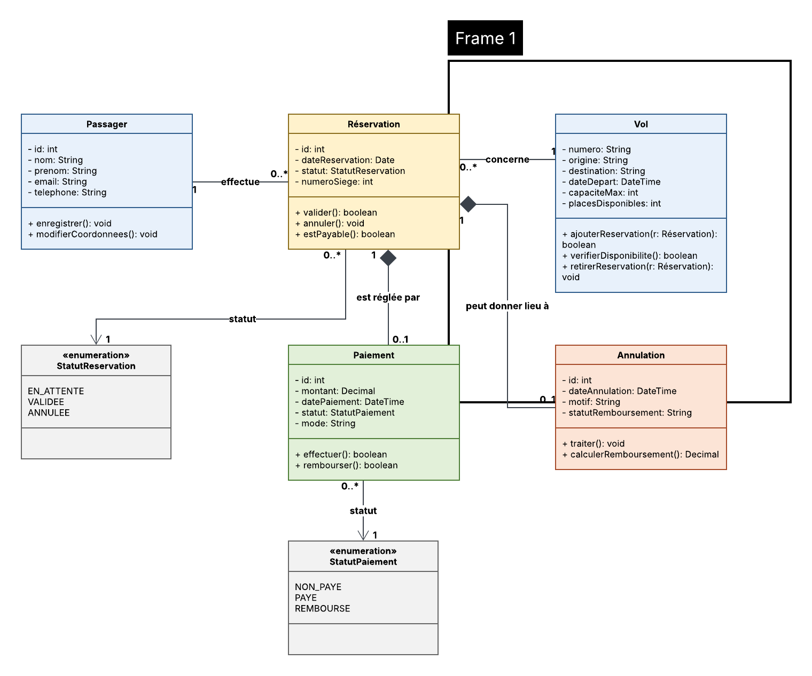

## 2. Conception orientée objet

### 2.1 Classes principales

-   `Passager` : représente une personne qui achète un billet.
-   `Vol` : représente un trajet aérien programmé.
-   `Reservation` : relie un passager à un vol.
-   `Paiement` : conserve les informations d'un règlement.
-   `AgenceVoyage` : centralise les collections et les opérations de
    gestion.

### 2.2 Relations entre les classes

-   Un passager peut effectuer plusieurs réservations.
-   Un vol peut être concerné par plusieurs réservations.
-   Une réservation concerne exactement un passager et un vol.
-   Une réservation peut posséder plusieurs paiements (par exemple, en
    cas de paiement en plusieurs fois).
-   L'agence gère les passagers, les vols, les réservations et les
    paiements.# Projet C++ --- Gestion d'une agence de voyage

> **Objectif :** concevoir une application console en C++ permettant de
> gérer les passagers, les vols, les réservations, les paiements et les
> annulations de billets d'avion.

Ce document présente l'analyse, la conception, les règles de gestion,
les diagrammes à insérer et une implémentation de référence en C++17.

------------------------------------------------------------------------

## 1. Analyse du problème

L'agence souhaite centraliser les informations relatives aux billets
d'avion. L'application doit permettre à un utilisateur (agent de voyage)
d'enregistrer les passagers, de créer les vols, de réserver des places,
d'enregistrer les paiements et d'annuler les réservations.

### 1.1 Acteurs

-   **Agent de voyage :** utilise l'application pour effectuer les
    opérations de gestion.
-   **Passager :** personne pour laquelle une réservation est effectuée.
    Dans cette première version, le passager n'utilise pas directement
    le logiciel.

### 1.2 Besoins fonctionnels

  -----------------------------------------------------------------------
  Module                              Fonctionnalités
  ----------------------------------- -----------------------------------
  Passagers                           Ajouter, afficher, rechercher et
                                      modifier les passagers

  Vols                                Ajouter, afficher, rechercher les
                                      vols et consulter les places
                                      disponibles

  Réservations                        Réserver un vol pour un passager,


### 2.3 Diagramme de classes

Ajoutez votre propre image dans le dossier `images`, puis remplacez le
nom du fichier ci-dessous si nécessaire.



------------------------------------------------------------------------

## 3. Architecture du projet

Pour un projet simple, le code ci-dessous peut être placé dans un seul
fichier `main.cpp`. Pour une meilleure organisation, voici une structure
possible :

``` text
AgenceVoyage/
│
├── README.md
├── images/
│   ├── diagramme-classes.png
|── main.cpp
```

### 3.1 Environnement

-   Langage : C++
-   Standard : C++17
-   Type d'application : console
-   Bibliothèques utilisées : `iostream`, `vector`, `string`, `iomanip`,
    `limits`

Compilation avec g++ :

``` bash
g++ -std=c++17 -Wall -Wextra -pedantic src/main.cpp -o agence
```

Exécution :

``` bash
./agence
```

Sous Windows :

``` bash
agence.exe
```

------------------------------------------------------------------------

## 4. Implémentation complète en C++

Copiez le code suivant dans `src/main.cpp`.

------------------------------------------------------------------------

## 5. Explication du fonctionnement

### 5.1 Gestion des passagers

L'agent choisit l'option 1, puis saisit les informations du passager.
L'application attribue automatiquement un identifiant et stocke l'objet
dans le vecteur `passagers`.

### 5.2 Gestion des vols

L'agent choisit l'option 3 et renseigne le numéro du vol, les villes, la
date, l'heure, le prix et la capacité. Le programme refuse un numéro de
vol déjà utilisé.

### 5.3 Gestion des réservations

Pour réserver un billet, l'agent saisit l'identifiant d'un passager
existant et celui d'un vol existant. Le programme vérifie la
disponibilité d'une place et empêche une double réservation active du
même vol par le même passager.

Une réservation est créée avec le statut `EN_ATTENTE`.

### 5.4 Gestion des paiements

L'agent choisit une réservation et saisit le montant, la date et le mode
de paiement. Les paiements partiels sont acceptés. Lorsque la somme
payée atteint le prix total, le statut passe à `CONFIRMEE`.

### 5.5 Gestion des annulations

L'agent saisit le numéro de réservation. Si celle-ci existe et n'est pas
déjà annulée, son statut devient `ANNULEE` et une place est libérée sur
le vol.

Dans cette version pédagogique, l'annulation ne déclenche pas de
remboursement automatique. Cette règle peut être ajoutée selon les
exigences de l'agence.

------------------------------------------------------------------------

## 6. Exemple de scénario de test

1.  Ajouter le passager : AGBODJAN, Paul.
2.  Ajouter le vol : BJ101, Cotonou vers Paris, prix 350000 FCFA,
    capacité 50.
3.  Créer une réservation pour le passager sur le vol BJ101.
4.  Effectuer un paiement de 150000 FCFA : le statut reste `EN_ATTENTE`.
5.  Effectuer un deuxième paiement de 200000 FCFA : le statut devient
    `CONFIRMEE`.
6.  Afficher les paiements pour vérifier les deux opérations.
7.  Annuler la réservation : le statut devient `ANNULEE` et une place
    est libérée.

**Résultat attendu :** le programme doit afficher les informations
saisies, empêcher les réservations lorsque le vol est complet et mettre
à jour le statut selon les paiements et les annulations.

------------------------------------------------------------------------

## 7. Améliorations possibles

Pour rendre le logiciel plus complet, on pourrait ajouter :

-   la modification et la suppression des passagers ;
-   la recherche d'un passager par son identifiant ou son nom ;
-   la modification et la suppression des vols (avec vérification des
    réservations existantes) ;
-   la recherche de vols par ville et par date ;
-   la génération d'un billet avec un code de réservation ;
-   la gestion des remboursements en cas d'annulation ;
-   la sauvegarde des données dans des fichiers ou une base de données ;
-   la gestion des utilisateurs et des mots de passe ;
-   la validation stricte des dates, heures, adresses e-mail et numéros
    de passeport.

------------------------------------------------------------------------

## 8. Conclusion

Cette solution met en pratique les notions fondamentales de la
programmation orientée objet en C++ : classes, objets, attributs privés,
méthodes publiques, constructeurs, encapsulation, relations entre objets
et utilisation de collections avec `vector`.

La classe `AgenceVoyage` coordonne les différentes opérations, tandis
que les classes `Passager`, `Vol`, `Reservation` et `Paiement`
représentent les éléments métier du système.

